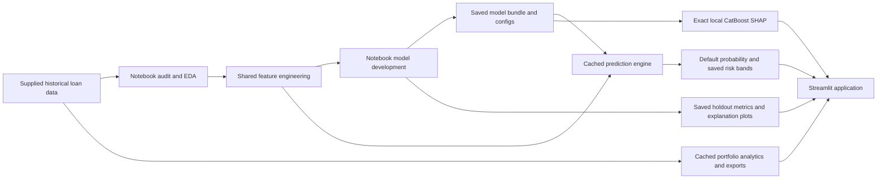

# NBFC Credit Risk Intelligence Platform

**Portfolio Analytics, Default Risk Prediction & Explainable Credit Intelligence**

## Overview

A complete Streamlit analytics application around the existing saved origination
model. It combines historical portfolio analysis, borrower default probabilities,
initial risk segmentation, exact local SHAP and honest model-performance evidence.
The app loads saved artifacts with caching and never retrains a model on startup
or interaction. No LLM, external API or API key is used.

## Business Problem

Credit-risk teams need to understand portfolio exposure and identify borrowers
with higher estimated default risk. This educational platform supports exploration
and human investigation; it does not approve or reject loans.

## Dataset

The user-supplied extracts contain **93,174 labeled loans** and **39,933
unlabeled test loans**, with target `default` (0 = Non-Defaulter, 1 = Defaulter).
Actual full-training default rate: **23.75%**. Applied loan
amounts sum to **$1,372,812,800**; this is not realized loss or
outstanding exposure. The source dictionary describes dollars and US-style state
codes. Amounts retain those units; no unsupported INR relabeling or FX conversion
is performed. Snapshot dates, source provenance and outcome horizon are unverified.

`Train.csv`, `Test.csv` and the supplied `Data_Dictionary_.csv` are kept intact.
The notebook also recognizes `Data_Dictionary.csv` and root or `data/` input paths.
Charts/exports state their population and preserve full-data KPIs when a histogram
clips its display tail. Each source row is treated as one loan/applicant record;
the supplied IDs are unique but do not establish repeat-person linkage.

## Data Quality & EDA

Phase 1 audits missingness, duplicates, IDs, numeric validity, schema and category
differences. The app provides grade, term, purpose, DTI, interest, housing,
experience, application-type and state exploration. Category default rates include
counts in hover details; executive rates show approximate 95% Wilson intervals.
Rare groups, missing values and chronology/maturity ambiguity qualify interpretation.

## Leakage Analysis

The primary model excludes `ID`, `default`, `interest_receive` and `last_week_pay`.
Interest received and months of EMI already paid are post-origination information.
Pricing, bank-assigned grades and verification are assumed available at the
specified assessment stage. Credit balances/history must be pre-loan snapshots;
the files cannot verify their timestamps. Strong ID-decile outcome differences
and counterintuitive grade patterns raise construction/chronology concerns even
though ID is excluded. The separate notebook monitoring comparison does not
establish a valid future-warning window.

## Feature Engineering

The app re-exports the exact Phase 1 implementation from
`models/feature_engineering.py` through `src/feature_engineering.py`; it does not
maintain another transformation copy. Loan term becomes years. Missing categorical
values use the exported tokens and job experience is lowercased. Affordability and
exposure ratios are `loan_to_income`, `credit_utilization`, `balance_to_income`
and `revolving_to_income`. Nonpositive denominators create missing ratios, not
infinity; values above 1 remain unchanged. Saved feature order/categorical positions
are validated when loading the model. The form uses **19 raw inputs**, transformed
into **23 model features**, as specified by `feature_config.json`.

`models/input_schema.json` contains categories, medians, numeric ranges and
dictionary help text derived from Train.csv. Assessment can work without the
analytics dataset because these UX definitions are persisted. The source CSV is
needed for analytics pages. Unknown categories, invalid numbers and artifact
problems show readable messages. Out-of-training-range values are flagged without
inventing a new preprocessing treatment.

## Modeling

The notebook compared Dummy, Logistic Regression, Random Forest and two modest
CatBoost candidates. It reserved a 20% holdout and separated fitting, tuning and
calibration. Selection occurred before holdout scoring. The chosen family is
**CatBoost**, with depth **7** and
**682 trees**, refitted on all labeled data.
The saved bundle includes the optional calibration mapping; the chosen mapping
was **none**, since sigmoid/isotonic did not improve the
independent calibration-check Brier score. The app does not recalibrate.

## Model Performance

Untouched holdout, **18,635 rows**, frozen threshold
**0.28**:

| Metric | Actual validation result |
|---|---:|
| Accuracy | 0.7928 |
| Precision | 0.5500 |
| Recall | 0.7004 |
| F1 | 0.6162 |
| ROC-AUC | 0.8440 |
| PR-AUC | 0.6751 |
| Brier | 0.1229 |
| Gini | 0.6881 |
| KS | 0.5295 |

PR-AUC denotes average precision. These metrics describe the frozen development
procedure, not in-sample refit accuracy. Optional explorer scores on historical
training rows are explicitly labeled **in-sample exploratory estimates** and
are not used as validation results. Saved performance plots and metric files are
read directly without retraining or manufactured chart values.

## Risk Segmentation

Boundaries were frozen from the tuning median, F1 threshold and 90th percentile:

| Band | Saved probability interval |
|---|---|
| Low | 0.00% to 14.46% |
| Moderate | 14.46% to 28.00% |
| High | 28.00% to 55.95% |
| Very High | 55.95% to 100.00% |

Intervals are left-closed/right-open, except the final interval includes 100%.
A boundary value enters the higher band. These are educational initial bands;
business loss costs/risk appetite and external validation should define real policy.

## Explainability

Global charts are the saved development-model SHAP results on up to 500 holdout
rows. Dynamic local explanations use the **actual final refitted CatBoost model**
and the exact submitted borrower inputs. Contributions plus the expected value
are checked against the raw model score. They add in **log-odds units**, not PD
units, and use association language. Correlated features can share attribution;
SHAP is not evidence of causation.

## Application Features

- Historical KPI cards, observed outcome rates and applied exposure.
- Nine category filters with intersected scope, reset and graceful empty states.
- Configuration-driven borrower form, saved threshold/bands and Plotly PD gauge.
- Borrower-to-historical-median comparisons and exact local SHAP contributions.
- Saved global explanations, feature relationships and actual holdout metrics.
- Paginated explorer (25–250 rows/page), optional cached model scores and full
  filtered CSV download. Original source data is never overwritten.
- Assessment JSON download, source-aware units and readable artifact/input errors.

## Screens / Dashboard Sections

Home · Executive Overview · Portfolio Analytics · Borrower Risk Assessment ·
Risk Explainability · Model Performance · Portfolio Explorer · About Project.
Runtime screenshots and interaction-check evidence live in `artifacts/app_review/`.

## Project Architecture



## Project Structure

```text
app.py
pages/                         Seven named application sections
src/                           Cached loaders, shared feature re-export,
                               prediction, risk/chart utilities and views
models/                        Original bundle, .cbm, metadata and risk configs
  input_schema.json            Source-backed form categories/defaults
  feature_engineering.py       Authoritative Phase 1 transformations
artifacts/metrics/              Original validation evidence
artifacts/plots/                Original modeling figures
artifacts/app_review/           Application QA and screenshots
tests/                         Prediction and Streamlit interaction smoke tests
scripts/                       Schema/docs preparation and browser QA
.streamlit/config.toml         Consistent native theme
requirements.txt               App runtime dependencies
requirements-notebook.txt      Additional notebook dependencies
01_NBFC_Loan_Default_Model.ipynb
README.md
```

## Installation

Use **Python 3.12**, matching the saved-model environment. From the project root:

```bash
python -m venv .venv
# Activate .venv for your operating system
python -m pip install -r requirements.txt
```

Windows activation: `.venv\Scripts\Activate.ps1`.
macOS/Linux activation: `source .venv/bin/activate`.
Pinning scikit-learn/CatBoost/joblib avoids serialized-model version mismatch.
Load only trusted model artifacts. No secrets or API keys are required.

## Run Locally

```bash
streamlit run app.py
```

The app does not invoke the notebook or any fitting routine. Resource caching
loads the model once per artifact signature. Data caching handles historical CSVs,
metric files, feature-relationship summaries and optional historical scores.
The cached model has a lock around prediction/SHAP operations for concurrent use.
Assessment inputs/results live only in the user's Streamlit session; no server-side
borrower submission log is written.

Verification:

```bash
python -m unittest discover -s tests -v
```

To rerun the modeling notebook separately (this refits models intentionally):

```bash
python -m pip install -r requirements-notebook.txt
python run_notebook.py
```

`build_notebook.py` is an authoring scaffold and overwrites the notebook with an
unexecuted copy; ordinary reruns do not need it. If modeling outputs change,
refresh the saved UX schema with `python scripts/prepare_input_schema.py` and
review the app compatibility/metrics. The original `predict.py` inference helper
is kept for Phase 1 compatibility; the application uses `src/prediction.py` with
the same authoritative transformations and cached bundle.

## Deployment

The project is prepared for Streamlit deployment; it has not been published to
an external account. Commit `app.py`, `pages/`, `src/`, `.streamlit/config.toml`,
`requirements.txt`, the required model/config artifacts, and data/metrics/plots
needed for the requested sections. Select `app.py` as the entry point and Python
3.12 in the deployment environment. Model binaries are about 3 MB each and are
not ignored. The CSVs are the supplied portfolio data: verify their distribution
rights/privacy before making a repository public. A deployment without Train.csv
can assess borrowers using input_schema.json but cannot show historical analytics.

The host must have sufficient CPU/memory for Plotly, CatBoost and the optional
historical scoring cache. Restart or invalidate caches after changing artifacts.
See [Streamlit deployment documentation](https://docs.streamlit.io/deploy/streamlit-community-cloud/deploy-your-app).

## Limitations

This is an educational demonstration, not a production lending engine or a claim
of regulatory compliance. Origination timing, snapshot dates, default horizon and
outcome maturity are unverified. ID and grade patterns suggest chronology or
construction artifacts. Random validation cannot establish prospective performance.
There are no real NBFC loss/recovery data, live monitoring timestamps or repeat-
borrower linkage checks. Behavior, economic regimes and model calibration may
drift. Refit thresholds/bands require external/time validation. Bias, subgroup
fairness and reliability need additional evaluation and human oversight.

## Future Improvements

Verify dated pre-loan snapshots and source provenance; define a future default
horizon; evaluate temporal/external performance and subgroup reliability; establish
business-cost thresholds; monitor calibration/drift; add validated loss/recovery
analytics and authenticated access if real borrower data are introduced. FastAPI
and generative AI are not part of this implementation.

## Author

**Manas Joshi**
# nbfc_predcn

