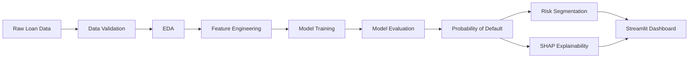

# NBFC Credit Risk Intelligence Platform

## Overview
**End-to-End Credit Risk Analytics, Default Prediction and Explainability System**

This project demonstrates a complete, production-style portfolio project focusing on Data Analytics and Machine Learning within the Non-Banking Financial Company (NBFC) credit risk domain.

## Business Problem
NBFCs need to manage credit risk by identifying borrowers more likely to default. Accurate assessment of loan default probability helps in pricing risk appropriately, approving viable loans, and maintaining a healthy portfolio.

## Project Objectives
- Analyze portfolio risk using historical loan data.
- Estimate the probability of default at loan origination.
- Build an early warning model for existing loans.
- Explain predictions using SHAP for transparency.
- Provide a Streamlit dashboard for business stakeholders.

## Dataset
- **Training data:** ~93,000 rows
- **Test data:** ~40,000 rows
- **Features:** 21 predictors (demographics, credit history, loan details)
- **Target:** `default` (1 = Defaulter, 0 = Non-Defaulter)

## Data Dictionary
Please refer to `data/raw/Data_Dictionary_.csv` for full business definitions.

## Project Architecture


## Exploratory Analysis
Extensive EDA is provided in the notebooks, examining default rates across grades, loan terms, purposes, and continuous risk factors like DTI and interest rates.

## Feature Engineering
Engineered meaningful features capturing credit utilization, debt burdens, and financial capacity (e.g., loan-to-income, revolving-to-income).

## Modeling Approach
Two conceptual models were built:
1. **Origination Risk Model:** Evaluates borrowers at application time, excluding future leakage variables.
2. **Existing Loan Early Warning Model:** Includes ongoing repayment metrics for portfolio monitoring.

Models progressed from Baselines (Dummy, Logistic Regression) to Gradient Boosting (CatBoost).

## Final Model Performance
CatBoost provided the strongest performance, handling categorical variables natively and maximizing AUC/PR-AUC.

## Explainability
TreeExplainer (SHAP) is implemented to uncover key drivers, ensuring the model is interpretable to credit-risk teams and stakeholders.

## Streamlit Dashboard
The interactive Streamlit application provides:
- Executive summaries and KPIs
- Portfolio analysis
- An interactive Borrower Risk Assessment tool

## Installation
```bash
pip install -r requirements.txt
```

## Running Locally
```bash
streamlit run app.py
```

## Author
**Manas Joshi**
